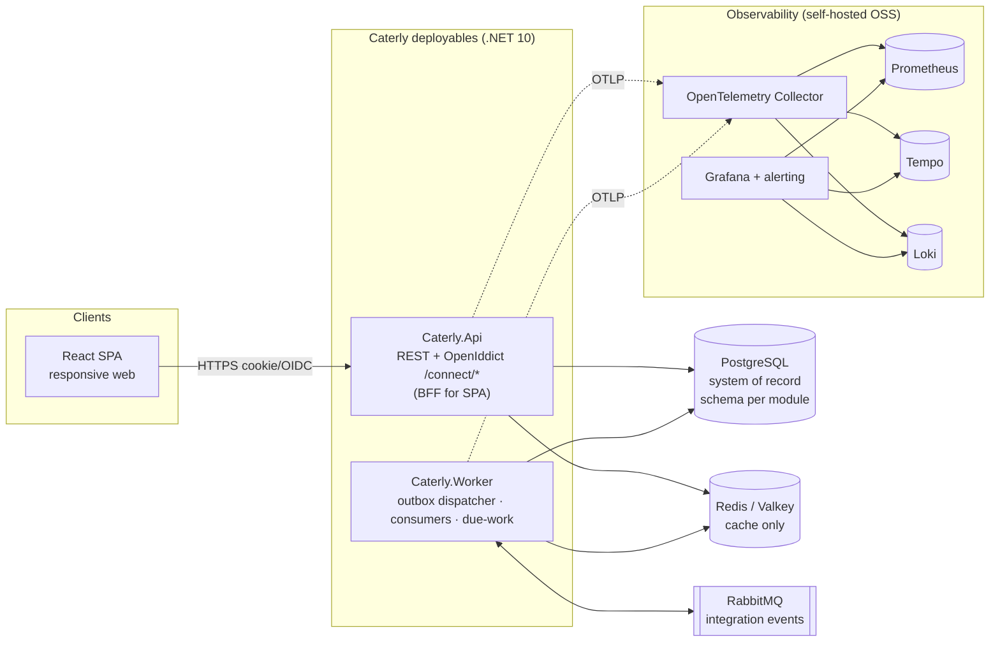

# Caterly — System architecture

- **Status:** Draft. Stack accepted (ADR-0003); integration choices proposed (ADR-0004).
- **Owner decisions pending:** listed in §12.
- **Applies to:** every feature design. A feature design in `docs/architecture/<area>.md`
  references the sections it relies on and records any deviation.

## 1. Requirements

### Functional scope
Two areas, from `CLAUDE.md` and `docs/requirements/`:
- **Corporate meal management:** agreements, employees, calendars, selection, cutoff,
  finalization and billing (CMD-001…056).
- **Regular customer ordering:** the draft flows; their Open items are not decided.

Roles:
- platform admin;
- catering operator (operations, kitchen, finance);
- corporate admin;
- employee;
- regular customer, guest or registered.

### Non-functional requirements (assumptions to confirm, §12)
| Attribute | Target (MVP) |
|---|---|
| Scale | ≤ 100 tenants, ≤ 1,000 corporate accounts, ≤ 100k employees |
| Load | ~150k selections/day. Peak in the last 30 min before a lunch cutoff ≈ 50–100 writes/s and 300 reads/s. Small for one PostgreSQL primary. |
| Latency | p95 < 300 ms for reads, p95 < 500 ms for selection submit (server time) |
| Availability | 99.5% monthly for the API. Finalization must run within 5 min of its due time. |
| Durability | Zero loss of committed business data. RPO ≤ 5 min, RTO ≤ 4 h. |
| Correctness | Money, cutoff, tenancy and finalization are always enforced server-side, transactionally, in PostgreSQL |
| Region | Bangladesh users. Store UTC; default service timezone Asia/Dhaka. |
| Cost | Only free, open-source software (ADR-0003). Self-hosted. |

### Constraints
- A small team, mostly AI agents.
- Modular monolith (ADR-0001). No microservices or event sourcing.
- Responsive web only.

## 2. High-level design



**Write path.**
1. An HTTP command runs a handler, which checks authorization and tenancy.
2. The domain logic runs, then a single PostgreSQL transaction commits:
   - the aggregate changes;
   - the audit row;
   - any outbox rows.
3. The API returns its response.
4. Later, the Worker dispatches the outbox rows to RabbitMQ, and consumers in the Worker
   react. Consumers are idempotent through the inbox.

**Read path.**
- An HTTP query projects tenant-scoped data to DTOs, using `AsNoTracking`.
- Read-mostly reference data goes through `HybridCache`: L1 in memory, L2 in Redis.

**Synchronous vs asynchronous.**
- Anything that decides a business outcome is **synchronous and transactional**: selection
  acceptance, cutoff, capacity, finalization, money and audit.
- Asynchronous messaging is only for **consequences**: notifications, read-model refresh,
  cache invalidation fan-out, imports, report generation and exports.

## 3. Solution layout

```
backend/src/
  Caterly.Domain/           pure model (rules: domain-layer.md)
  Caterly.Application/      use cases, ports, integration event contracts
  Caterly.Infrastructure/   EF Core, Redis, RabbitMQ, OpenIddict stores, OTel/Serilog wiring
  Caterly.Api/              HTTP endpoints, OIDC server endpoints, BFF, ProblemDetails
  Caterly.Worker/           Generic Host: outbox dispatcher, consumers, due-work runner
  Caterly.ServiceDefaults/  shared host wiring: Serilog, OpenTelemetry, health checks, config
```
`Caterly.ServiceDefaults` exposes `builder.AddCaterlyDefaults()`. The API and the Worker both
call it, so every host gets the same logging, tracing, metrics and health checks.

## 4. Data
- **One PostgreSQL database with one schema per module** (ADR-0004 D8). Each module has its
  own `DbContext` mapped to its schema, or one context with per-module configurations (to be
  decided in the first persistence design). Either way, there are no cross-schema foreign keys
  between modules. Modules reference each other by ID.
- **Tenancy:**
  - `TenantId` on every tenant-owned row;
  - EF global query filters;
  - an explicit scope check in every handler;
  - PostgreSQL RLS as an optional later layer.
- **Shared infrastructure schemas:**
  - `messaging`: `outbox`, `inbox`;
  - `scheduling`: `due_work`;
  - `audit`: `audit_entry`, append-only;
  - `identity`: ASP.NET Core Identity and OpenIddict tables.
- **Concurrency:** `xmin` optimistic concurrency on contended aggregates. Unique constraints
  for business uniqueness.
- **Backups:** pgBackRest (MIT): full and differential backups plus continuous WAL archiving
  for point-in-time recovery. Restores are tested regularly.

## 5. Messaging (RabbitMQ)
- **Topology:**
  - One durable topic exchange per publishing module: `caterly.<module>` (for example
    `caterly.menus`).
  - Routing key: `<module>.<event>.v<major>` (for example `menus.menu_item_changed.v1`).
  - Each consumer owns one durable **quorum queue**: `caterly.<consumer-module>.<purpose>`.
    It binds only the keys it needs.
  - Dead-lettering:
    - every queue has the dead-letter exchange `caterly.dlx` (direct), its own
      `x-dead-letter-routing-key` = `<queue>`, and a bound queue `<queue>.dlq`;
    - quorum queues use `x-dead-letter-strategy: at-least-once` with
      `x-overflow: reject-publish`, so dead-lettered messages are not lost;
    - `x-delivery-limit` is set explicitly (default 5, not the broker default of 20).
- **Envelope:** both headers and body carry:
  - `messageId` (UUID v7), `type`, `version`;
  - `tenantId`, `occurredAtUtc`;
  - `correlationId`, `causationId`, `traceparent`/`tracestate` (W3C).
  - The body holds only IDs and the facts needed. It never contains secrets, payment data or
    unnecessary PII.
- **Outbox:**
  1. The handler inserts outbox rows in the business transaction.
  2. The dispatcher claims batches with `SKIP LOCKED`.
  3. It publishes with publisher confirms and marks the rows sent.
  4. It retries with backoff.
  - Delivery is **at least once**.
- **Inbox:** a consumer records `(consumer, messageId)` with a unique constraint in the same
  transaction as its effect. A duplicate message is acknowledged with no effect.
- **Retries:** bounded retries with delay (per-queue TTL retry queues), then the DLQ.
  - A DLQ depth above 0 triggers an alert.
  - Replay is a manual, audited operation.
- **Versioning:** only additive changes within a major version. A breaking change publishes
  `v2` next to `v1` until all consumers have migrated.

## 6. Caching (Redis)
- **Engine:** `HybridCache`, with L1 in memory and L2 in Redis through
  `Microsoft.Extensions.Caching.StackExchangeRedis` (`IDistributedCache` over `StackExchange.Redis`).
  Redis is **never** the source of truth. The system must work correctly, only slower, if
  Redis is down.
- **Keys:** `caterly:{env}:{tenantId|global}:{module}:{name}:{id}:v{schema}`. Every entry has
  a TTL. Tenant-scoped data always includes the `tenantId` in the key.
- **Invalidation:** remove the cache entry by tag or key in Redis after commit. `HybridCache`
  has no L1 backplane, so in-memory L1 entries on other instances expire only on their own.
  L1 expiry is therefore 30 s or less, and entries that affect access disable L1.
- **Allowed:**
  - published menus and calendars;
  - service and agreement configuration;
  - a user's resolved permission scope: Redis only (no L1), TTL ≤ 60 s, removed in the
    revoking request after commit, read from PostgreSQL if Redis is down;
  - lookup data.
- **Forbidden:**
  - capacity or availability used for acceptance;
  - cutoff decisions;
  - balances or invoice totals;
  - anything whose staleness changes money or eligibility.
- **Other Redis uses:** distributed rate limiting for login and public endpoints, and
  short-lived OTP or attempt counters once an SMS vendor is chosen. Redis is **not** used for
  locks that protect correctness; those use PostgreSQL constraints and transactions.

## 7. Identity and access (OpenIddict)
- **Authorization server:** OpenIddict inside `Caterly.Api` (ADR-0004 D5), with ASP.NET Core
  Identity as the user store, both in PostgreSQL.
- **Flows:**
  - Authorization code + PKCE for interactive users, through the BFF or a public client
    (owner decision D6).
  - Client credentials for future machine integrations.
  - No implicit flow and no password grant.
- **Tokens:** short-lived access tokens (≤ 10 min). Refresh tokens rotate, and reuse is
  detected. Signing keys are kept outside the repository and rotated. Token and authorization
  entries are pruned on a schedule.
- **Claims are minimal:** `sub`, the tenant membership, and the role. Fine-grained permissions
  and the corporate scope (account, permitted locations) are resolved **server-side** for each
  request from PostgreSQL (cached in Redis with a short TTL and invalidated on change). A
  stale token therefore cannot widen access (CMD-014). A revocation applies to the next
  request once its cache entry is removed. In the worst case (the Redis removal fails) it
  applies within the scope TTL. The owner decides the maximum acceptable delay (§12).
- **Authorization:** ASP.NET Core policies per permission, plus resource and tenant checks in
  handlers. Out-of-scope resources return 404.
- **Accounts:** individual accounts only; shared employee logins are not allowed (CMD-020).
  Password policy, lockout and MFA follow ASP.NET Core Identity defaults, tightened as needed.
- **Platform admin access:** cross-tenant access by platform admins is explicit, per
  request, and audited.
- **Audit:** sign-in, sign-out, failed sign-ins, lockouts, role and permission changes, and
  token revocations.

## 8. Observability
### Logging (Serilog)
- Logs go out as JSON to stdout, and over OTLP (`Serilog.Sinks.OpenTelemetry`) to the
  Collector and then to Loki.
- Bootstrap logger at startup. `UseSerilogRequestLogging` writes one summary event per
  request.
- **Enrichment** on every event:
  - `TraceId`, `SpanId`, `CorrelationId`;
  - `TenantId`, `UserId` (the internal ID only);
  - `Module`, `Environment`, `ServiceName`, `ServiceVersion`.
- **Levels:**
  - `Information` for business milestones (selection accepted, finalization completed);
  - `Warning` for handled rule violations at an unusual rate, and retries;
  - `Error` for failures that need attention.
- **Never logged:** passwords, tokens, cookies, OTPs, payment data, full request bodies, or
  PII beyond internal IDs.

### Tracing (OpenTelemetry)
- **Instrumentation:**
  - ASP.NET Core and HttpClient;
  - Npgsql/EF Core;
  - StackExchange.Redis;
  - RabbitMQ: context is propagated through message headers, so a trace links the HTTP
    command, the outbox, the publish and the consumer.
- **Custom spans:** one `ActivitySource` named `Caterly.<Module>` for important use cases
  (finalization, imports, billing runs).
- **Sampling:** the application records every trace (parent-based, always on), and the
  Collector makes the decision. It runs the `otelcol-contrib` distribution with the
  `tail_sampling` processor, which keeps all traces with errors, all slow traces, and a
  configured ratio of the rest. Ratio sampling in the application would drop error traces
  before the Collector sees them, so it is used only as an emergency load valve.

### Metrics (OpenTelemetry → Prometheus)
- **Runtime:** ASP.NET Core and .NET runtime metrics (GC, thread pool, exceptions).
- **Business and platform metrics**, from a `Meter` named `Caterly`:
  - `caterly.selection.submitted`, `caterly.selection.rejected{reason}`;
  - `caterly.finalization.duration`, `caterly.finalization.lag`;
  - `caterly.outbox.pending`, `caterly.outbox.age`;
  - `caterly.consumer.failed{consumer}`.
- **Labels must have low cardinality:** never user, employee, order or tenant IDs. Per-tenant
  analysis uses traces and logs, which carry `TenantId`.

### Health and monitoring
- **Health checks:** `/health/live` (the process is up) and `/health/ready` (PostgreSQL,
  RabbitMQ and Redis reachable). Redis is marked *degraded*, not *unhealthy*.
- **Grafana dashboards:**
  - API RED metrics (rate, errors, duration);
  - Worker throughput, outbox age and DLQ depth;
  - PostgreSQL (`postgres_exporter`), RabbitMQ (built-in Prometheus plugin) and Redis
    (`redis_exporter`);
  - business KPIs.
- **Alerts:**
  - API 5xx above 2% for 5 min;
  - selection submit p95 above 1 s;
  - finalization overdue by more than 5 min (**critical**);
  - outbox age above 2 min;
  - DLQ depth above 0;
  - a dependency down;
  - certificate or signing-key expiry under 14 days;
  - disk above 80%.
- **External uptime:** Uptime Kuma (MIT) or a Grafana synthetic probe on the public health
  endpoint.

## 9. Reliability
| Failure | Behavior |
|---|---|
| RabbitMQ down | Commands still succeed. The outbox grows and the dispatcher retries. Alert on outbox age. |
| Redis down | Cache misses go to PostgreSQL and rate limiting falls back to in-memory. Readiness is degraded. |
| Worker down | Business commands still work. Finalization is overdue, which triggers a critical alert. Work catches up after restart because due work is persisted. |
| Duplicate HTTP submit | An idempotency key with a unique constraint returns the first result. |
| Duplicate message | The inbox deduplicates it. |
| Concurrent selections near cutoff or capacity | Transaction + `xmin` or a unique constraint. The loser gets 409 or 422. |
| PostgreSQL primary loss | Restore or failover from the WAL archive or a streaming replica. RPO ≤ 5 min. |

**Scaling.** The API and the Worker are stateless and scale horizontally. Data protection
keys are stored in PostgreSQL. PostgreSQL scales vertically first, with a read replica for
reports later. RabbitMQ and Redis run as single nodes in MVP, with quorum queues ready for a
3-node cluster.

## 10. Local development (target, implemented in slice P1)
`docker compose up -d` runs:
- PostgreSQL;
- Redis or Valkey;
- RabbitMQ with the management UI;
- the Aspire Dashboard (OTLP on 4317/4318, UI on 18888).

The full Grafana stack is available as an optional compose profile (`--profile observability`).

## 11. Free/open-source inventory (verify licenses when adding — `dependencies.md`)
| Purpose | Package / tool | License |
|---|---|---|
| Logging | Serilog, Serilog.AspNetCore, Serilog.Sinks.Console, Serilog.Sinks.OpenTelemetry | Apache 2.0 |
| Telemetry SDK | OpenTelemetry .NET (+ Instrumentation.AspNetCore/Http/Runtime, Exporter.OpenTelemetryProtocol), Npgsql.OpenTelemetry | Apache 2.0 / PostgreSQL |
| Identity | OpenIddict (AspNetCore, EntityFrameworkCore), ASP.NET Core Identity | Apache 2.0 / MIT |
| Messaging | RabbitMQ.Client | Apache 2.0 / MPL 2.0 |
| Cache | Microsoft.Extensions.Caching.Hybrid, Microsoft.Extensions.Caching.StackExchangeRedis, StackExchange.Redis | MIT |
| Instrumentation | OpenTelemetry.Instrumentation.StackExchangeRedis (**prerelease**: needs owner OK, or omit), RabbitMQ.Client.OpenTelemetry | Apache 2.0 |
| Data protection keys | Microsoft.AspNetCore.DataProtection.EntityFrameworkCore | MIT |
| Log masking | Destructurama.Attributed | Apache 2.0 |
| Test helpers | Microsoft.Extensions.Diagnostics.Testing (`FakeLogger`), Microsoft.Extensions.TimeProvider.Testing | MIT |
| Health checks | AspNetCore.HealthChecks.NpgSql / Redis / Rabbitmq | Apache 2.0 |
| Tests | xUnit v3, Testcontainers (PostgreSQL, Redis, RabbitMQ) | Apache 2.0 / MIT |
| Servers | PostgreSQL, RabbitMQ, Valkey or Redis Open Source, OTel Collector, Prometheus, Grafana, Loki, Tempo, Aspire Dashboard, pgBackRest, Uptime Kuma | OSS (Grafana stack: AGPLv3) |

**Explicitly not used** (paid or restricted):
- MassTransit v9+, NServiceBus;
- MediatR v13+, AutoMapper v15+, FluentAssertions v8+;
- Duende IdentityServer;
- Hangfire Pro;
- Seq (its free tier is limited);
- Application Insights, Datadog, New Relic;
- the Elastic stack (not chosen; its AGPL option exists since 8.16, but it is heavier than Loki).

## 12. Owner decisions
1. **ADR-0004 D1–D8.** Recommendation: accept as written.
2. **D6, web authentication:** BFF cookie (recommended) or code + PKCE in the SPA.
3. **NFR targets in §1.** Confirm or adjust scale, latency, availability, RPO and RTO.
4. **Hosting and deployment target** (VPS, Kubernetes or managed PostgreSQL). Not decided;
   it affects backups, TLS and secrets management.
5. **Regular-customer identity:** one account across tenants or per tenant? Is guest checkout
   unauthenticated? These come from the draft flows, which are Open.
6. **Sign-in methods:** password only for MVP, or phone OTP? An SMS vendor is not chosen
   (CLAUDE.md).
7. **Tenant routing** for public storefronts (subdomain, path or custom domain). Not decided.
8. **Finalization trigger and due time.** CMD-040 does not say when finalization runs. With the
   Administrator-assignment policy, admins act after cutoff and before finalization. Options:
   a fixed offset after cutoff, a configured time per service, or a manual trigger with a
   deadline. The `scheduling.due_work` mechanism supports all three.
9. **Maximum revocation delay** for permission changes (recommendation: immediate on the
   next request, at most 60 s if Redis fails; §6–7).

## 13. Implementation slices (platform)
| Slice | Content | Risk |
|---|---|---|
| P1 | Compose: Redis, RabbitMQ, Aspire Dashboard. `Caterly.ServiceDefaults` with Serilog, OpenTelemetry and health checks, wired into the API. Docs. | high (deps/config) |
| P2 | `Caterly.Worker` host. `messaging` schema: outbox and inbox. Dispatcher and consumer base, with Testcontainers tests (RabbitMQ + PostgreSQL). | high (migration) |
| P3 | `scheduling.due_work` and the runner, with tests. | high (migration) |
| P4 | HybridCache + Redis wiring, key builder, tenant-key tests. | high (deps) |
| P5 | OpenIddict + Identity (stores, `/connect/*`, the chosen D6 pattern, policies, auth audit), with integration tests for 401, 403 and cross-tenant access. | high (auth) |
| P6 | Monitoring: Grafana stack compose profile, dashboards as code, alert rules. | high (config) |

Feature work (agreements, selection, …) builds on P1–P5. Every slice is designed first and
built test-first (`.claude/rules/design-first.md`, `.claude/rules/tdd.md`).

## 14. What to revisit as Caterly grows
- A read replica or separate reporting store when reports slow down the primary.
- RLS for defense in depth when the number of tenants grows.
- Moving the authorization server to its own host when integrations or native apps arrive.
- A 3-node RabbitMQ and Redis cluster when uptime targets rise.
- Splitting a module into a service only with evidence (load, team or release cadence) and a
  new ADR.
