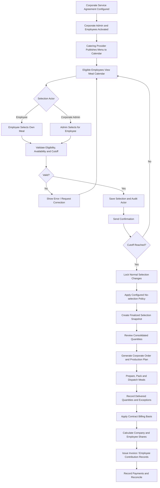

# Caterly — Corporate Meal Management: Final Business Decisions

**Document version:** 1.0  
**Status:** Finalized business baseline  
**Product:** Caterly  
**Market:** Bangladesh  
**Decision date:** 26 November 2026

---

## 1. Purpose

This document records the finalized business rules for Caterly's Corporate Meal Management capability. It is intended to be the authoritative business decision baseline for requirements, UX, domain modeling, and implementation.

The decisions already approved by the product owner are preserved. Additional operational defaults are finalized here to make the workflow implementable. Items explicitly marked **Open implementation detail** do not change the approved business model; they require a later integration or technical choice.

## 2. Confirmed product-owner decisions

| ID | Area | Final decision | Status |
|---|---|---|---|
| CMD-001 | Payment model | Support company-funded, employee-funded, and shared allowance models | Confirmed |
| CMD-002 | Meal selection | Both employees and authorized corporate administrators can select meals | Confirmed |
| CMD-003 | Portal access | Support desktop and mobile-friendly access through responsive web portals | Confirmed |
| CMD-004 | No-selection policy | Configurable per corporate service/contract | Confirmed |

These decisions are mandatory requirements.

---

## 3. Final business decisions

### 3.1 Corporate customer and service agreement

| ID | Decision | Final rule |
|---|---|---|
| CMD-005 | Corporate account structure | A corporate customer can have multiple office locations/branches. |
| CMD-006 | Service agreements | A corporate customer can have multiple service agreements with the same catering provider, provided each agreement has a distinct scope or term. |
| CMD-007 | Service configuration | Meal schedules, locations, service days, menus, pricing, cutoff rules, payment model, and no-selection policy are configured at the service-agreement/service level. |
| CMD-008 | Service activation | A service cannot become Active until required locations, contacts, pricing, schedule, payment model, and meal policies are configured. |
| CMD-009 | Agreement changes | Changes to commercial terms or service rules must be effective-dated. Historical orders and invoices must retain the terms used when they were created. |

### 3.2 Corporate portal and access

| ID | Decision | Final rule |
|---|---|---|
| CMD-010 | Access channels | Provide responsive web access for desktop, tablet, and mobile browsers. |
| CMD-011 | Native apps | Native Android/iOS applications are not a prerequisite for the initial release. |
| CMD-012 | Corporate administrator | Corporate administrators can manage authorized locations, departments, employees, eligibility, and meal selections. |
| CMD-013 | Employee portal | Eligible employees can view their meal calendar, select meals, change/cancel selections before cutoff, and view their own selection history. |
| CMD-014 | Role boundaries | Corporate administrators can act only within their assigned corporate account and permitted locations. |
| CMD-015 | Audit | The system records who performed each selection or change, when it happened, and whether it was an employee or administrator action. |

### 3.3 Employee onboarding and eligibility

| ID | Decision | Final rule |
|---|---|---|
| CMD-016 | Employee registration | Corporate administrators can add employees individually or import them in bulk. |
| CMD-017 | Required employee data | Maintain a corporate employee identifier, name, account/contact identifier, status, department where used, location, and eligibility. |
| CMD-018 | Eligibility | Meal eligibility is assigned by the corporate administrator and can be limited by location, service, meal period, and effective dates. |
| CMD-019 | Employment status | Inactive or suspended employees cannot make new selections after the effective status change. Historical records remain available. |
| CMD-020 | Employee account | Employee portal access is individually authenticated; shared employee logins are not permitted. |

### 3.4 Meal calendar and menu publication

| ID | Decision | Final rule |
|---|---|---|
| CMD-021 | Calendar view | Employees can view available meals by service date and meal period in a calendar-based interface. |
| CMD-022 | Menu publication | The catering provider controls menu creation and publication for each corporate service/location. |
| CMD-023 | Publication window | Menus may be published for one date or a future date range. Recurring publication may be supported where configured. |
| CMD-024 | Availability | Each published menu item must have availability/capacity rules where the provider needs quantity control. |
| CMD-025 | Menu changes | Changes to a published menu must be recorded. If an affected employee has already selected the changed item, the system must notify the relevant employee/admin and apply the configured replacement or cancellation process. |
| CMD-026 | Meal periods | A service can define meal periods such as breakfast, lunch, snacks, or dinner. |

### 3.5 Meal selection and changes

| ID | Decision | Final rule |
|---|---|---|
| CMD-027 | Selection actors | Employees can select for themselves; authorized corporate administrators can select on behalf of employees. |
| CMD-028 | One selection | Default rule: one active meal selection per employee, service date, and meal period. Multiple meals are allowed only when explicitly enabled by the service. |
| CMD-029 | Eligibility validation | A selection is accepted only if the employee is eligible for that service, location, date, and meal period. |
| CMD-030 | Availability validation | The system validates menu publication, item availability, capacity, and cutoff before accepting a selection. |
| CMD-031 | Pre-cutoff changes | Employees can change or cancel their own selection before the configured cutoff. Administrators can manage selections for employees within their permissions. |
| CMD-032 | Post-cutoff changes | Normal employee changes are locked after cutoff. An authorized corporate administrator or catering operator may request/perform an exception only when granted the relevant permission. |
| CMD-033 | Override reason | Every post-cutoff override must record actor, timestamp, reason, previous value, and new value. |
| CMD-034 | Selection confirmation | A successful selection or change must return a confirmation to the actor and update the employee's selection view. |
| CMD-035 | Selection history | Employees can view their own history. Corporate administrators can view authorized employee and summary records. |

### 3.6 Cutoff and finalization

| ID | Decision | Final rule |
|---|---|---|
| CMD-036 | Cutoff configuration | Cutoff is configurable by corporate service and may vary by service date or meal period. |
| CMD-037 | Timezone | Bangladesh services use Asia/Dhaka as the default timezone. |
| CMD-038 | Cutoff behavior | At cutoff, normal employee selection and changes stop automatically. |
| CMD-039 | No-selection processing | The configured no-selection policy is applied after cutoff. |
| CMD-040 | Finalization | The system creates a finalized snapshot of employee selections and policy-assigned meals for the service date/meal period. |
| CMD-041 | Operations review | Catering operations can review consolidated quantities and record an authorized adjustment before production. |
| CMD-042 | Snapshot integrity | Finalized selections and quantities are not silently overwritten. Post-finalization changes create auditable adjustments or a new version. |

### 3.7 No-selection policy

**Confirmed decision:** Configurable.

The service administrator must select one of these policies:

| Policy | Final behavior |
|---|---|
| No meal | No meal is ordered for an employee who made no selection. |
| Default meal | The configured default meal is assigned automatically, subject to eligibility and availability. |
| Administrator assignment | The corporate administrator reviews the unselected list and assigns meals before finalization. |

**Default recommendation for a newly created service:** `No meal`.

Reason: it avoids producing or charging for an unrequested meal by default. The corporate customer may explicitly choose another policy in the service agreement.

The system must identify the origin of each finalized meal as employee-selected, administrator-selected, or automatically assigned.

### 3.8 Payment and employee contributions

**Confirmed decision:** All three payment models must be supported.

| Model | Company pays | Employee pays |
|---|---|---|
| Company-funded | 100% of the agreed billable amount | 0% |
| Employee-funded | 0%, unless a separate subsidy is configured | 100% |
| Shared allowance | Configured company allowance/subsidy | Remaining employee contribution |

Final rules:

1. The payment model is configured per corporate service agreement.
2. The system stores gross meal value, company contribution, employee contribution, and each party's billable amount separately.
3. Allowances may be configured as a fixed amount, percentage, or another agreed pricing rule, subject to the pricing model supported by the product.
4. The calculation must be reproducible from the applicable contract and price snapshot.
5. Changes to allowance or pricing rules apply prospectively from their effective date and must not silently recalculate historical invoices.
6. Company and employee receivables must be separately identifiable.
7. A corporate invoice must not include employee contributions unless the agreement explicitly makes the company responsible for collecting or settling them.

**Open implementation detail:** The collection channel for employee contributions (online payment, payroll deduction, or another settlement method) is not fixed by this business decision. Payroll integration is not assumed for the initial release. Caterly must at minimum record employee contribution amounts and their collection/settlement status.

### 3.9 Billing basis and reconciliation

| ID | Decision | Final rule |
|---|---|---|
| CMD-043 | Billing frequency | Billing frequency is defined by the service agreement (for example, daily, weekly, or monthly). |
| CMD-044 | Billing basis | The service agreement explicitly defines the billable quantity basis. |
| CMD-045 | Recommended default | Use finalized meal quantity as the default billable basis for contracted meals, unless the agreement specifies delivered quantity or another basis. |
| CMD-046 | Delivery reconciliation | Prepared, dispatched, and delivered quantities are recorded separately from finalized quantities. |
| CMD-047 | Discrepancies | Shortages, rejected meals, cancellations, and approved adjustments are recorded and handled according to the agreement. |
| CMD-048 | Invoice detail | Corporate invoices identify the service agreement, billing period, service dates/locations, quantities, rates, company allowance, adjustments, and net amount due. |
| CMD-049 | Payment allocation | Full and partial payments, advances, credits, and outstanding balances are supported and allocated to the relevant corporate account/invoice. |
| CMD-050 | Disputes | Corporate invoice disputes can be recorded with disputed amount, reason, owner, and resolution history. |

**Important:** The default finalized-quantity basis is a commercial recommendation for the standard contract. The actual agreement may choose delivered quantity or another explicitly stated basis. This prevents billing expectations from being ambiguous.

### 3.10 Holidays, service suspension, and exceptions

| ID | Decision | Final rule |
|---|---|---|
| CMD-051 | Service calendar | Each service defines operating days and non-service days/holidays. |
| CMD-052 | Closed dates | Employees cannot select meals for dates on which the service is closed. |
| CMD-053 | Temporary suspension | Authorized users can suspend a service or location for a defined period with a reason. |
| CMD-054 | Capacity exception | If demand exceeds capacity, the system must prevent over-selection or flag the excess for authorized resolution. |
| CMD-055 | Unavailable meal | If a selected meal becomes unavailable, the system must notify affected users and record replacement, cancellation, or other resolution. |
| CMD-056 | Service cancellation | A cancelled service date must be reflected in selections, orders, notifications, and billing adjustments according to contract terms. |

### 3.11 Corporate reporting

The corporate administrator should be able to view:

- Employee eligibility and active status.
- Daily selection completion status.
- Employees with no selection.
- Selections by date, meal period, location, and department.
- Employee-level meal history, subject to permissions.
- Finalized meal quantities.
- Company allowance and employee contribution summaries.
- Relevant invoice and billing summaries.

The catering provider should additionally view:

- Consolidated order quantities.
- Production quantities.
- Prepared, dispatched, and delivered quantities.
- Delivery discrepancies.
- Corporate billing and outstanding balances.

---

## 4. Final end-to-end corporate meal workflow

---

## 5. Acceptance criteria

The corporate meal capability is acceptable when all of the following are demonstrated:

1. A catering provider can create a corporate account with multiple service locations.
2. A corporate account can have multiple service agreements.
3. Each service agreement can configure schedules, meal periods, menus, prices, payment model, cutoff, and no-selection policy.
4. Corporate administrators can access the portal from desktop and mobile browsers.
5. Employees can access their own meal calendar from desktop and mobile browsers.
6. Corporate administrators can add/import employees and assign eligibility.
7. Employees can select meals for eligible dates and meal periods.
8. Corporate administrators can select meals on behalf of employees.
9. The system records the actor for every selection and change.
10. Selection validation enforces eligibility, availability, capacity, and cutoff.
11. Employees can change or cancel selections before cutoff.
12. Post-cutoff changes require authorized exception handling and an audit reason.
13. The no-selection policy can be configured as no meal, default meal, or administrator assignment.
14. Cutoff automatically locks normal selection changes.
15. Finalization creates a traceable snapshot.
16. Consolidated orders can be generated by service date, meal period, and location.
17. Production, dispatch, and delivery quantities are tracked separately.
18. The system supports company-funded, employee-funded, and shared allowance models.
19. Corporate and employee financial responsibilities are separately traceable.
20. Billing follows the basis defined in the service agreement.
21. Invoices, payments, credits, disputes, and outstanding balances are auditable.
22. Service closures, unavailable meals, and delivery exceptions can be handled without losing history.

---

## 6. Items intentionally not fixed by this decision

These are implementation or commercial integration details, not blockers to finalizing the business workflow:

| Item | Current position |
|---|---|
| Employee contribution collection channel | Record receivables/status; choose payment or payroll integrations separately |
| Native Android/iOS applications | Not required for initial release; responsive web is required |
| Payment gateway provider | Select during payment integration planning |
| Payroll provider/integration | Not assumed |
| SMS/email vendors | Select during notification integration planning |
| Tax/VAT treatment | Must follow the applicable business and legal requirements; confirm with finance/accounting before invoicing implementation |

---

## 7. Decision summary

The corporate meal business model is finalized around these principles:

- Contract-driven corporate services.
- Multiple corporate locations and service agreements.
- Responsive web portals for corporate administrators and employees.
- Employee self-selection and administrator-assisted selection.
- Configurable meal calendars, eligibility, cutoff, and no-selection policies.
- Immutable/versioned selection finalization.
- Consolidated operational orders with employee-level traceability.
- Company-funded, employee-funded, and shared allowance payment models.
- Contract-defined billing basis and separate financial responsibility tracking.
- Auditable changes, fulfillment discrepancies, invoices, and payments.

**Status: Finalized business baseline.** Any future change should be recorded as a new decision/version rather than silently changing these rules.
